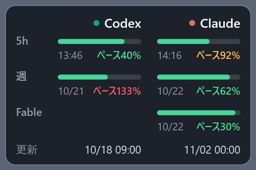
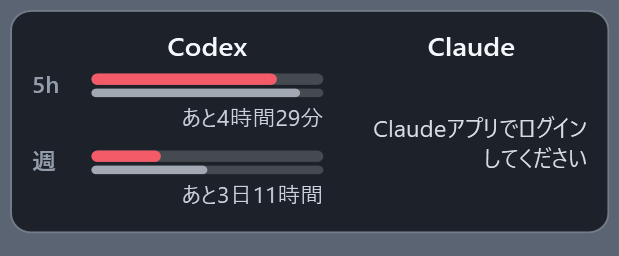

# Usage Widget for Codex & Claude

CodexとClaudeの5時間枠・週間枠を、Windowsデスクトップに並べて常駐表示するウィジェットです。

> **非公式** — OpenAI・Anthropicによる提供・承認・サポートを受けた製品ではありません。



## 画面表示の補足

- **列** — サービスごと（Codex / Claude）。行ラベル（5h・週・更新）は左端に1回だけ表示
- **ゲージ** — 2本のバーを並べ、どちらも時間とともに右から左へ縮む
  - **上（太い・色付き）** — 残り利用量
  - **下（白）** — リセットまでの残り時間
  - **読み方** — 上が下より長ければ、今のペースでもリセットまで持つ。短ければ使いすぎ
  - **色** — 今のペースのままリセット時点で何%使うか。緑（85%未満）・黄（85〜100%）・赤（100%超＝使い切る見込み）。期間の始まり直後（全体の5%未満）は灰色
  - **その枠がない列** — 空欄
- **行の振り分け** — 1日以内の枠は「5h」、それより長い枠は「週」の行
- **モデル別の週間枠** — ClaudeのFableのように特定モデルだけに掛かる週間枠があれば、そのモデル名の行を追加。枠のない列は空欄
- **ゲージの下の文字** — リセットまでの残り時間（例: あと2日3時間）。7日以外の枠は左に「30日枠」のように長さも表示
- **ツールチップ** — 列にマウスを乗せると、枠ごとの正確な「残り○%」と最終更新を表示
- **更新** — サブスク更新日（手入力、サービスごと）。毎月同じ日時へ自動更新し、存在しない日付は月末に補正。どれも未設定なら行ごと非表示
- **取得できない場合** — その列に理由だけを表示



## 表示項目の切り替え

右クリック →「表示する項目」から、続けて切り替えられます。

- **サービス** — Codex / Claude（最低1つは表示）
- **利用枠** — 5時間枠 / 週間枠（最低1つは表示） / モデル別の週間枠（Fableなど）
- **詳細** — リセットまでの残り時間 / サブスク更新日

## 利用条件

- **OS** — Windows 10/11（x64）
- **Codex** — アプリまたはCLIをインストールし、ログイン済みであること
- **Claude** — Claudeデスクトップアプリ、またはClaude Code CLIでログイン済みであること（追加のログイン操作は不要）
- **.NET** — Release版には同梱済み。追加インストール不要

## インストール

1. **ダウンロード** — [最新のRelease](https://github.com/snsnsnsnsnsn/usage-widget-for-codex/releases/latest)から `CodexUsageWidget.exe` を取得
2. **配置** — EXEを固定フォルダーへ移動
3. **起動** — EXEを実行

## 操作上の注意

- **設定** — ウィジェットまたは通知領域アイコンを右クリック（同じメニュー）
- **クリック透過** — 通知領域アイコンから解除可能
- **EXEの移動** — 自動起動を一度解除し、移動後に再設定
- **SmartScreen** — コード未署名のため、初回に警告が出る場合あり

## データの取得とプライバシー

- **Codex** — ログイン済みの公式Codex（app-server）から取得。取得できない場合はPC内のCodex記録から利用制限だけを読む
- **Claude** — 既存のログイン情報を読み取り専用で使い、`api.anthropic.com` の使用量APIから取得。既定の間隔は3分
  - **読む順番** — Claude Code CLIの `~/.claude/.credentials.json` → Claudeデスクトップアプリの `%APPDATA%\Claude\config.json`
  - **デスクトップアプリ** — アプリがWindowsのユーザー保護（DPAPI）で暗号化して保存しているトークンを、同じユーザーとして復号して使う。送信先は `api.anthropic.com` のみ
  - **注意** — アプリ内部の保存形式に依存するため、アプリの更新で読めなくなる場合がある
- **認証** — 各公式クライアントに任せ、APIキーやログイン情報を保存・更新しない。Claudeのログインが期限切れなら、Claudeアプリを開くと更新される
- **会話内容** — ウィジェットでは保存・表示・外部送信しない

## アンインストール

- **本体** — 自動起動を解除し、アプリを終了してEXEを削除
- **設定** — 必要なら `%LOCALAPPDATA%\CodexUsageWidget` を削除

## ビルド

- **必要環境** — .NET 8 SDKまたはVisual Studio 2022

```powershell
dotnet build .\CodexUsageWidget.sln -c Release
dotnet run --project .\CodexUsageWidget.Tests -c Release
.\build-release.ps1
```

## ライセンス

[MIT License](LICENSE)
